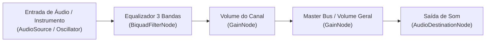

# 🎵 MusicalModel — Plataforma de Ensino Musical & Simulador de Áudio Interativo

> **Trabalho de Conclusão de Curso (TCC)**  
> **Backend:** Java 25 | Spring Boot | Spring Data JPA | Spring Web | Spring Security   

---

## 📌 1. Objetivo do Projeto

O **MusicalModel** é uma plataforma educacional e interativa voltada para o aprendizado prático de música e produção de áudio. O projeto une a gestão pedagógica de alunos, cursos e instrumentos à experiência prática de um **Simulador de Mesa de Som (Mixer de Áudio)** diretamente no navegador e em aplicativo desktop.

### Principais Objetivos:
- **Democratizar o Ensino Musical:** Permitir que estudantes tenham acesso a cursos estruturados de instrumentos musicais, controle de matrícula, contagem de horas de estudo e planos de assinatura.
- **Prática Sonora em Tempo Real:** Disponibilizar um simulador virtual de mesa de som com canais independentes (equalização de agudo, médio, grave e volume individual) e controle de volume master.
- **Arquitetura Moderna e de Alta Concorrência:** Backend robusto desenvolvido com as tecnologias mais modernas do ecossistema Java, focado em escalabilidade, segurança e baixa latência.

---

## 🎛️ 2. A Mesa de Som Virtual & APIs do Navegador (Web Audio API)

Um dos maiores diferenciais técnicos do projeto é a integração entre o backend e a interface visual de simulação de áudio desenhada

Para que a mesa de som funcione com fidelidade, sem latência perceptível e sem a necessidade de plugins externos, o front-end utiliza a **Web Audio API** nativa do W3C:



### Como os Nós de Áudio se conectam com o Modelo de Dados:
1. **`AudioContext`**: O grafo principal que processa o áudio em tempo real na thread de áudio do navegador.
2. **Canais da Mesa (`CanalModel`)**:
   - Cada canal representa uma trilha sonora independente (microfone, teclado, guitarra, bateria, etc.).
   - **Equalização (EQ de 3 Bandas):**
     - **Grave (Bass):** Manipulado por um `BiquadFilterNode` configurado como `lowshelf` (frequências em torno de 100 Hz – 250 Hz).
     - **Médio (Mid):** Manipulado por um `BiquadFilterNode` configurado como `peaking` (frequências em torno de 1 kHz – 2.5 kHz).
     - **Agudo (Treble):** Manipulado por um `BiquadFilterNode` configurado como `highshelf` (frequências acima de 4 kHz – 8 kHz).
   - **Volume do Canal:** Controlado por um `GainNode` dedicado ligado aos faders da interface.
3. **Volume Master (`SimuladorModel`)**:
   - Um nó mestre (`GainNode`) que soma todos os canais e aplica o `volume_master` antes de enviar o sinal para os alto-falantes (`audioContext.destination`).
---

## 🚀 3. Tecnologias Utilizadas no Backend

O backend foi construído utilizando as versões e padrões mais recentes da engenharia de software Java:

- **Linguagem:** Java 25 (OpenJDK)
- **Framework Principal:** Spring Boot 4.x / 3.x
- **Persistência de Dados:** Spring Data JPA / Hibernate
- **Banco de Dados:** PostgreSQL
- **Segurança & Criptografia:** Spring Security 6, BCrypt Password Encoder
- **Autenticação:** JWT (JSON Web Token) via Auth0 (`java-jwt`)
- **Processamento Concorrente:** Java Virtual Threads (Project Loom)
- **Camada de Cache:** Spring Cache Abstraction (Cache em Memória)
- **Produtividade & Boilerplate:** Lombok
- **Validação de Dados:** Jakarta Bean Validation (`spring-boot-starter-validation`)

---

## 🔐 4. Arquitetura de Segurança & Controle de Acesso (RBAC)

O sistema adota autenticação **Stateless** com JWT e controle de permissões baseado em papéis (**Role-Based Access Control**):


### Divisão de Papéis e Permissões:
- **`ROLE_ALUNO` (Tipo 1):** Acesso aos cursos, acompanhamento de matrículas, gerenciamento do seu simulador de mesa de som e perfil.
- **`ROLE_ADMIN` (Tipo 2):** Acesso administrativo restrito garantido via anotações `@PreAuthorize("hasRole('ADMIN')")`:
  - Listagem geral de usuários (`GET /musicalmodel/usuario`).
  - Ativação/desativação de contas (`PATCH /musicalmodel/usuario/{id}/ativo`).
  - Cadastro, alteração e exclusão de cursos e instrumentos.
  - Exclusão de registros.
- **Defesa em Profundidade de Dados Sensíveis:**
  - O campo `senha` no `UsuarioModel` utiliza `@JsonProperty(access = Access.WRITE_ONLY)`, impedindo vazamento de hashes criptográficos.
  - O retorno de dados de usuários é encapsulado em **`UsuarioResponseDto`**, ocultando dados internos e expondo apenas informações seguras.

---

## ⚡ 5. Alta Performance: Virtual Threads & Cache

### Java Virtual Threads (Project Loom)
Configurado diretamente no `application.properties`:
```properties
spring.threads.virtual.enabled=true
```
- A cada requisição HTTP, o Tomcat aloca uma **Virtual Thread** ultraleve gerenciada pela JVM (poucos bytes de memória).
- Ao realizar operações de I/O (espera de banco de dados PostgreSQL ou cache), a thread virtual é suspensa sem bloquear a CPU física, permitindo que a aplicação suporte **milhares de conexões simultâneas** com baixo consumo de hardware.

### Estratégia de Cache
A camada de cache foi desacoplada na regra de negócio (**Services**):
- **Leituras Frequentes (`@Cacheable`):**
  - `@Cacheable("cursos")`: Catálogo de cursos.
  - `@Cacheable("instrumentos")`: Lista de instrumentos musicais.
  - `@Cacheable("usuarios")`: Lista administrativa de usuários.
- **Invalidação Automática (`@CacheEvict`):**
  - Toda operação de escrita (`save`, `update`, `delete`, `patch`) limpa a respectiva região com `allEntries = true`, garantindo consistência imediata dos dados.

---

## 📁 6. Estrutura de Pastas do Projeto

O código-fonte segue a arquitetura em camadas limpa e separada por responsabilidades:

```text
src/main/java/com/fag/musicalmodel/
│
├── config/                 # Configurações de Segurança, Filtros e JWT
│   ├── JWTUserData.java    # Record do usuário extraído do token
│   ├── SecurityConfig.java # Cadeia de filtros e @EnableMethodSecurity
│   ├── SecurityFilter.java # Filtro interceptor e injeção de Grants/Roles
│   └── TokenConfig.java    # Geração e validação de tokens JWT
│
├── controller/             # Controladores REST da API
│   ├── CanalController.java
│   ├── CursoController.java
│   ├── InstrumentoController.java
│   ├── MatriculaController.java
│   ├── SimuladorController.java
│   ├── TipoUsuarioController.java
│   └── UsuarioController.java
│
├── dto/                    # Objetos de Transferência de Dados
│   ├── request/            # DTOs de Entrada (validados com Bean Validation)
│   │   ├── CanalRequestDto.java
│   │   ├── CursoRequestDto.java
│   │   ├── InstrumentoRequestDto.java
│   │   ├── LoginDto.java
│   │   ├── MatriculaRequestDto.java
│   │   ├── SimuladorRequestDto.java
│   │   ├── TipoUsuarioRequestDto.java
│   │   └── UsuarioRequestDto.java
│   └── response/           # DTOs de Saída (sem campos sensíveis)
│       ├── LoginResponse.java
│       └── UsuarioResponseDto.java
│
├── enums/                  # Enumerações de Domínio
│   ├── StatusMatricula.java# PENDENTE, ATIVA, CANCELADA, CONCLUIDA
│   └── UserRole.java       # ALUNO (1L, ROLE_ALUNO), ADMIN (2L, ROLE_ADMIN)
│
├── model/                  # Entidades JPA mapeadas no PostgreSQL
│   ├── CanalModel.java
│   ├── CursoModel.java
│   ├── InstrumentoModel.java
│   ├── MatriculaModel.java
│   ├── SimuladorModel.java
│   ├── TipoUsuarioModel.java
│   └── UsuarioModel.java
│
├── repository/             # Interfaces de acesso a dados (Spring Data JPA)
└── service/                # Regras de negócio, transações e controle de cache
```

---

## 📡 7. Principais Endpoints da API

| Método | Endpoint | Permissão | Descrição |
| :--- | :--- | :--- | :--- |
| `POST` | `/musicalmodel/usuario/login` | Pública | Realiza login e retorna o Token JWT |
| `POST` | `/musicalmodel/usuario` | Pública | Cadastro inicial de usuário |
| `GET` | `/musicalmodel/usuario` | `ROLE_ADMIN` | Lista todos os usuários (com Cache) |
| `GET` | `/musicalmodel/usuario/{id}` | Autenticado | Busca usuário por ID |
| `PATCH`| `/musicalmodel/usuario/{id}/ativo` | `ROLE_ADMIN` | Ativa ou desativa usuário |
| `PATCH`| `/musicalmodel/usuario/{id}/assinatura`| Autenticado | Atualiza status de assinatura |
| `DELETE`| `/musicalmodel/usuario/{id}` | `ROLE_ADMIN` | Exclui usuário por ID |
| `GET` | `/musicalmodel/curso` | Autenticado | Lista todos os cursos (com Cache) |
| `POST` | `/musicalmodel/curso` | `ROLE_ADMIN` | Cadastra novo curso |
| `GET` | `/musicalmodel/instrumentos` | Autenticado | Lista instrumentos musicais |
| `POST` | `/musicalmodel/matricula` | Autenticado | Realiza matrícula em um curso |
| `PATCH`| `/musicalmodel/matricula/{id}/status` | Autenticado | Atualiza status da matrícula |
| `GET` | `/musicalmodel/canal/simulador/{id}`| Autenticado | Obtém os canais da mesa de som |

---

## ⚙️ 8. Como Executar o Projeto

### Pré-requisitos:
- **Java 21 ou superior** (Recomendado: **Java 25**) instalado e configurado no `JAVA_HOME`.
- **PostgreSQL** rodando localmente (porta 5432) com um banco de dados chamado `MusicalModel`.
- **Maven** instalado (ou via IDE).

### 1. Clonar o repositório:
```bash
git clone https://github.com/seu-usuario/MusicalModel.git
cd MusicalModel/MusicalModel
```

### 2. Configurar o banco de dados:
Verifique o arquivo `src/main/resources/application.properties`:
```properties
spring.datasource.url=jdbc:postgresql://localhost:5432/MusicalModel
spring.datasource.username=SEU_USUARIO_AQUI
spring.datasource.password=SUA_SENHA_AQUI
```

### 3. Compilar e executar:
```bash
# Compilar o projeto
mvn clean compile

# Rodar a aplicação
mvn spring-boot:run
```

A API estará disponível em: `http://localhost:8080/musicalmodel`

---

## 🎓 9. Contexto Acadêmico

Este projeto compõe o Trabalho de Conclusão de Curso (TCC) na área de Engenharia de Software, demonstrando a aplicação prática de engenharia de software de ponta, computação musical interativa na web, arquitetura modular em camadas e segurança defensiva.
