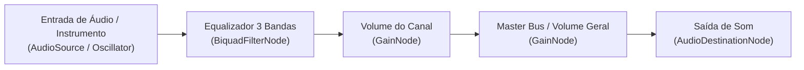

# MusicalModel — Plataforma de Ensino Musical e Simulador de Áudio Interativo

> **Trabalho de Conclusão de Curso (TCC)**  
> **Backend:** Java 25 | Spring Boot | Spring Data JPA | Spring Web | Spring Security | Redis | Swagger   

---

##  1. Objetivo do Projeto

O **MusicalModel** é uma plataforma educacional e interativa voltada para o aprendizado prático de música e produção de áudio. O projeto une a gestão pedagógica de alunos, cursos e instrumentos à experiência prática de um **Simulador de Mesa de Som (Mixer de Áudio)** diretamente no navegador e em aplicativo desktop.

### Principais Objetivos:
- **Democratizar o Ensino Musical:** Permitir que estudantes tenham acesso a cursos estruturados de instrumentos musicais, controle de matrícula, contagem de horas de estudo e planos de assinatura.
- **Prática Sonora em Tempo Real:** Disponibilizar um simulador virtual de mesa de som com canais independentes (equalização de agudo, médio, grave e volume individual) e controle de volume master.
- **Arquitetura Moderna e de Alta Concorrência:** Backend robusto desenvolvido com as tecnologias mais modernas do ecossistema Java, focado em escalabilidade, segurança e baixa latência.

---

## 2. A Mesa de Som Virtual & APIs do Navegador (Web Audio API)

Um dos maiores diferenciais técnicos do projeto é a integração entre o backend e a interface visual de simulação de áudio desenhada

Para que a mesa de som funcione com fidelidade, sem latência perceptível e sem a necessidade de plugins externos, o front-end utiliza a **Web Audio API** nativa do W3C:



### Como os Nós de Áudio se conectam com o Modelo de Dados:
1. **`AudioContext`**: O grafo principal que processa o áudio em tempo real na thread de áudio do navegador.
2. **Canais da Mesa (`CanalModel`)**:
   - Cada canal representa uma trilha sonora independente (microfone, teclado, guitarra, bateria, etc.).
   - **Equalização (EQ de 3 Bandas):**
     - **Grave (Bass):** Manipulado por um `BiquadFilterNode` configurado como `lowshelf` (frequências em torno de 100 Hz – 250 Hz).
     - **Médio (Mid):** Manipulado por um `BiquadFilterNode` configurado como `peaking` (frequências em torno de 1 kHz – 2.5 kHz).
     - **Agudo (Treble):** Manipulado por um `BiquadFilterNode` configurado como `highshelf` (frequências acima de 4 kHz – 8 kHz).
   - **Volume do Canal:** Controlado por um `GainNode` dedicado ligado aos faders da interface.
3. **Volume Master (`SimuladorModel`)**:
   - Um nó mestre (`GainNode`) que soma todos os canais e aplica o `volume_master` antes de enviar o sinal para os alto-falantes (`audioContext.destination`).
---

##  3. Tecnologias Utilizadas no Backend

O backend foi construído utilizando as versões e padrões mais recentes da engenharia de software Java:

- **Linguagem:** Java 25 (OpenJDK)
- **Framework Principal:** Spring Boot 4.x
- **Persistência de Dados:** Spring Data JPA / Hibernate
- **Banco de Dados:** PostgreSQL
- **Segurança & Criptografia:** Spring Security 6, BCrypt Password Encoder
- **Autenticação:** JWT (JSON Web Token) via Auth0 (`java-jwt`)
- **Processamento Concorrente:** Java Virtual Threads (Project Loom)
- **Camada de Cache:** Spring Cache Abstraction com **Redis**
- **Documentação da API:** Swagger / OpenAPI (`springdoc-openapi`)
- **Infraestrutura Local:** Docker Compose (PostgreSQL + Redis)
- **Produtividade & Boilerplate:** Lombok
- **Validação de Dados:** Jakarta Bean Validation (`spring-boot-starter-validation`)

---

##  4. Arquitetura de Segurança & Controle de Acesso (RBAC)

O sistema adota autenticação **Stateless** com JWT e controle de permissões baseado em papéis (**Role-Based Access Control**):


### Divisão de Papéis e Permissões:
- **`ROLE_ALUNO` (Tipo 1):** Acesso aos cursos, acompanhamento de matrículas, gerenciamento do seu simulador de mesa de som e perfil.
- **`ROLE_ADMIN` (Tipo 2):** Acesso administrativo restrito garantido via anotações `@PreAuthorize("hasRole('ADMIN')")`:
  - Listagem geral de usuários (`GET /musicalmodel/usuario`).
  - Ativação/desativação de contas (`PATCH /musicalmodel/usuario/{id}/ativo`).
  - Cadastro, alteração e exclusão de cursos e instrumentos.
  - Exclusão de registros.
- **Defesa em Profundidade de Dados Sensíveis:**
  - O campo `senha` no `UsuarioModel` utiliza `@JsonProperty(access = Access.WRITE_ONLY)`, impedindo vazamento de hashes criptográficos.
  - O retorno de dados de usuários é encapsulado em **`UsuarioResponseDto`**, ocultando dados internos e expondo apenas informações seguras.
  - As matrículas são retornadas como **`MatriculaResponseDto`** (apenas id/nome do usuário e id/título do curso), evitando expor os dados completos do usuário.
  - Os getters internos do Spring Security em `UsuarioModel` (`getPassword`, `getAuthorities` etc.) usam `@JsonIgnore`, então não aparecem em respostas nem no Swagger.
- **Usuário desativado:** com a senha errada o login responde `401 E-mail ou senha inválidos` (não revela que a conta existe); com a senha certa responde `403 Usuário desativado`. Tokens já emitidos param de funcionar na hora (`401`), pois o `SecurityFilter` confere no banco a cada requisição se o usuário ainda existe e está ativo.

### Tratamento de Erros
Todas as respostas de erro usam o formato `{"erro": "..."}`, exceto a validação de campos, que retorna `{"campo": "mensagem"}`. Isso vale também para os erros do Spring Security (`401`/`403`) e para os erros tratados pelo `ErroController` (`/error`).

| Situação | Status |
| :--- | :--- |
| Campo obrigatório ausente, acima do tamanho máximo ou fora da faixa (ex.: volume fora de 0 a 100) | `400` com `{"campo": "mensagem"}` |
| JSON malformado, parâmetro ausente, tipo inválido, número decimal em campo inteiro ou enum inválido (com a lista de valores aceitos) | `400` |
| E-mail ou senha inválidos no login; token ausente, inválido, expirado ou de usuário desativado/excluído | `401` |
| Login de usuário desativado (com a senha certa) ou sem permissão para a rota (ex.: ALUNO em rota de ADMIN) | `403` |
| Recurso inexistente (`ResourceNotFoundException`) ou rota inexistente | `404` |
| Valor duplicado (e-mail, CPF, título, nome), registro em uso ao excluir, ou regra de negócio violada (`BusinessException`) | `409` |

---

## 5. Alta Performance: Virtual Threads & Cache

### Java Virtual Threads (Project Loom)
Configurado diretamente no `application.properties`:
```properties
spring.threads.virtual.enabled=true
```
- A cada requisição HTTP, o Tomcat aloca uma **Virtual Thread** ultraleve gerenciada pela JVM (poucos bytes de memória).
- Ao realizar operações de I/O (espera de banco de dados PostgreSQL ou cache), a thread virtual é suspensa sem bloquear a CPU física, permitindo que a aplicação suporte **milhares de conexões simultâneas** com baixo consumo de hardware.

### Estratégia de Cache (Redis)
O cache é armazenado no **Redis** (`spring.cache.type=redis`) com expiração de **10 minutos** e foi desacoplado na regra de negócio (**Services**):
- **Leituras Frequentes (`@Cacheable`):**
  - `@Cacheable("cursos")`: Catálogo de cursos.
  - `@Cacheable("instrumentos")`: Lista de instrumentos musicais.
  - `@Cacheable("matriculas")`: Lista geral de matrículas.
  - `@Cacheable("tipousuario")`: Tipos de usuário.
- **Invalidação Automática (`@CacheEvict`):**
  - Toda operação de escrita (`save`, `update`, `delete`, `patch`) limpa a respectiva região com `allEntries = true`, garantindo consistência imediata dos dados.
- **Cache em DTO:** os caches de cursos e matrículas guardam `CursoResponseDto` e `MatriculaResponseDto` em vez das entidades, pois relacionamentos *lazy* do Hibernate não podem ser carregados depois de lidos do Redis.
- **Dados copiados entre caches:** a matrícula em cache guarda o título do curso e o nome do usuário, então alterar ou excluir um curso ou usuário também limpa o cache `matriculas`.
- Ao mudar o formato de um objeto em cache, limpe o Redis (`redis-cli FLUSHALL`) antes de subir a nova versão, ou aguarde o TTL de 10 minutos.

---

##  6. Estrutura de Pastas do Projeto

O código-fonte segue a arquitetura em camadas limpa e separada por responsabilidades:

```text
src/main/java/com/fag/musicalmodel/
│
├── config/                 # Configurações de Segurança, Filtros, JWT e Swagger
│   ├── ErroController.java # Respostas de /error no formato {"erro"}
│   ├── GlobalExceptionHandler.java # Tratamento global de erros
│   ├── JacksonConfig.java  # Recusa número decimal em campo inteiro
│   ├── JWTUserData.java    # Record do usuário extraído do token
│   ├── RespostaErro.java   # Escreve {"erro"} nas respostas 401/403 da segurança
│   ├── SecurityConfig.java # Cadeia de filtros e @EnableMethodSecurity
│   ├── SecurityFilter.java # Filtro interceptor e injeção de Grants/Roles
│   ├── SwaggerConfiguration.java # Configuração do OpenAPI e autenticação JWT
│   └── TokenConfig.java    # Geração e validação de tokens JWT
│
├── controller/             # Controladores REST da API
│   ├── CanalController.java
│   ├── CursoController.java
│   ├── InstrumentoController.java
│   ├── MatriculaController.java
│   ├── SimuladorController.java
│   ├── TipoUsuarioController.java
│   └── UsuarioController.java
│
├── dto/                    # Objetos de Transferência de Dados
│   ├── request/            # DTOs de Entrada (validados com Bean Validation)
│   │   ├── CanalNomeRequestDto.java
│   │   ├── CanalRequestDto.java
│   │   ├── CursoRequestDto.java
│   │   ├── InstrumentoRequestDto.java
│   │   ├── LoginDto.java
│   │   ├── MatriculaRequestDto.java
│   │   └── UsuarioRequestDto.java
│   └── response/           # DTOs de Saída (sem campos sensíveis)
│       ├── CursoResponseDto.java
│       ├── LoginResponse.java
│       ├── MatriculaResponseDto.java
│       └── UsuarioResponseDto.java
│
├── enums/                  # Enumerações de Domínio
│   ├── StatusMatricula.java# ATIVA, CONCLUIDA, CANCELADA, TRANCADA
│   └── UserRole.java       # ALUNO (1L, ROLE_ALUNO), ADMIN (2L, ROLE_ADMIN)
│
├── exception/              # Exceções de domínio
│   ├── BusinessException.java         # Regra de negócio violada (ex.: 409)
│   └── ResourceNotFoundException.java # Convertida em 404
│
├── model/                  # Entidades JPA mapeadas no PostgreSQL
│   ├── CanalModel.java
│   ├── CursoModel.java
│   ├── InstrumentoModel.java
│   ├── MatriculaModel.java
│   ├── SimuladorModel.java
│   ├── TipoUsuarioModel.java
│   └── UsuarioModel.java
│
├── repository/             # Interfaces de acesso a dados (Spring Data JPA)
└── service/                # Regras de negócio, transações e controle de cache
```

---

## 7. Principais Endpoints da API

| Método | Endpoint | Permissão | Descrição |
| :--- | :--- | :--- | :--- |
| `POST` | `/musicalmodel/usuario/login` | Pública | Realiza login e retorna o token JWT, `idUsuario`, `nome`, `role` e instrumento |
| `POST` | `/musicalmodel/usuario` | Pública | Cadastro inicial de usuário (sempre como ALUNO) |
| `PUT` | `/musicalmodel/usuario/{id}/instrumento/{idInstrumento}` | Autenticado (próprio usuário) | Define o instrumento gratuito; a escolha é permanente |
| `GET` | `/musicalmodel/usuario` | `ROLE_ADMIN` | Lista todos os usuários |
| `GET` | `/musicalmodel/usuario/{id}` | Autenticado | Busca usuário por ID |
| `PATCH`| `/musicalmodel/usuario/{id}/ativo` | `ROLE_ADMIN` | Ativa ou desativa usuário |
| `PATCH`| `/musicalmodel/usuario/{id}/assinatura`| Autenticado | Atualiza status de assinatura |
| `DELETE`| `/musicalmodel/usuario/{id}` | `ROLE_ADMIN` | Exclui usuário por ID |
| `GET` | `/musicalmodel/curso` | Autenticado | Lista todos os cursos (com Cache) |
| `POST` | `/musicalmodel/curso` | `ROLE_ADMIN` | Cadastra novo curso |
| `PATCH`| `/musicalmodel/curso/{id}/ativo` | `ROLE_ADMIN` | Ativa ou desativa curso (inativo não aceita matrículas) |
| `GET` | `/musicalmodel/instrumentos` | Autenticado | Lista instrumentos musicais (com Cache) |
| `GET` | `/musicalmodel/matricula` | Autenticado | Lista todas as matrículas (com Cache) |
| `POST` | `/musicalmodel/matricula` | Autenticado | Realiza matrícula em um curso |
| `PATCH`| `/musicalmodel/matricula/{id}/status` | Autenticado | Atualiza status da matrícula |
| `DELETE`| `/musicalmodel/matricula/{id}` | `ROLE_ADMIN` | Exclui matrícula |
| `GET` | `/musicalmodel/tipousuario` | `ROLE_ADMIN` | Lista tipos de usuário (com Cache). Não é possível criar tipos novos: existem só ALUNO e ADMIN |
| `GET` | `/musicalmodel/simulador/{idUsuario}` | Autenticado | Obtém o simulador do usuário |
| `PATCH`| `/musicalmodel/simulador/{idSimulador}/volume-master?volume=N` | Autenticado | Ajusta o volume master (0 a 100) |
| `GET` | `/musicalmodel/canal/{idSimulador}`| Autenticado | Obtém os 8 canais da mesa de som |
| `PUT` | `/musicalmodel/canal/{idCanal}`| Autenticado | Ajusta agudo, médio, grave e volume do canal (0 a 100) |
| `PATCH`| `/musicalmodel/canal/{idCanal}/nome`| Autenticado | Renomeia o canal (`{"nome": "Voz principal"}`, máx. 30 caracteres) |

### Regras de negócio
- **Cadastro:** o cadastro público sempre cria o usuário como ALUNO; o `idTipoUsuario` enviado é ignorado. Na edição (`PUT /usuario/{id}`), o tipo só muda quando quem chama é ADMIN. Um `idTipoUsuario` diferente de ALUNO (1) ou ADMIN (2) retorna `404 Tipo de usuário inexistente`.
- **E-mail:** é gravado sem espaços e em minúsculo, e o login aceita o e-mail com qualquer combinação de maiúsculas e minúsculas. Por isso `Fulano@Email.com` e `fulano@email.com` são o mesmo e-mail (`409` no segundo cadastro).
- **Nome do instrumento:** é gravado sem espaços nas pontas e em minúsculo (`Violão` vira `violão`), então nomes que só mudam a caixa contam como duplicados (`409`).
- **Instrumento:** depois do cadastro, o front chama `PUT /usuario/{id}/instrumento/{idInstrumento}` (sem corpo). O usuário só define o da própria conta, e só uma vez (`409` na segunda tentativa); o ADMIN pode trocar.
- **Simulador e canais:** no cadastro, cada usuário ganha um simulador (volume master 80) com **8 canais**, nomeados de "Canal 1" a "Canal 8", todos com agudo, médio, grave e volume em **50**. O cadastro segue a cadeia `UsuarioService` → `SimuladorService.criarSimulador` → `CanalService.criarCanaisPadrao` (laço de 1 a 8), tudo na mesma transação. Os canais não são criados nem removidos pela API; o front ajusta os valores pelo `PUT` (sempre números inteiros de **0 a 100**; decimais como `50.7` retornam `400`) e o nome pelo `PATCH /nome`. Valores, nomes e volume master ficam gravados no banco e voltam iguais na próxima sessão do usuário. Ao excluir o usuário, o simulador e os canais são removidos junto.
- **Conteúdo do curso:** coluna `TEXT`, com até **10.000 caracteres** (validado no DTO). Em bancos criados antes dessa mudança, rode uma vez: `ALTER TABLE tb_curso ALTER COLUMN conteudo TYPE TEXT;` (o `ddl-auto=update` não altera o tipo de colunas existentes).
- **Matrícula:** o usuário e o curso precisam estar ativos, e não pode haver duas matrículas `ATIVA` do mesmo usuário no mesmo curso (`409`).
- **Exclusão com vínculos:** curso com matrículas, instrumento ou tipo em uso e usuário com matrículas não podem ser excluídos (`409`). Para tirar um curso de circulação, desative-o.

A lista completa, com descrição, parâmetros e códigos de resposta de cada rota, está no **Swagger**: `http://localhost:8080/swagger-ui.html`. Para testar rotas protegidas, faça login, copie o token e cole no botão **Authorize**.

---

##  8. Como Executar o Projeto

### Pré-requisitos:
- **Java 25** instalado e configurado no `JAVA_HOME`.
- **Docker** (Docker Desktop) para subir o PostgreSQL e o Redis.
- **Maven** instalado, ou o wrapper `mvnw` incluído no projeto.

### 1. Clonar o repositório:
```bash
git clone https://github.com/seu-usuario/MusicalModel.git
cd MusicalModel/MusicalModel
```

### 2. Configurar as variáveis de ambiente:
Copie os arquivos de exemplo e preencha as senhas e a chave do JWT:
```bash
cp .env.example .env
cp src/main/resources/application.properties.example src/main/resources/application.properties
```

### 3. Subir o PostgreSQL e o Redis:
```bash
docker compose up -d
```

| Serviço | Porta local | Container |
| :--- | :--- | :--- |
| PostgreSQL | `5435` | `musicalmodel-postgres` |
| Redis | `6381` | `musicalmodel-redis` |

As portas foram escolhidas para não conflitar com outros projetos que usam as padrões (`5432`/`5433` e `6379`). Se precisar mudar, ajuste o `docker-compose.yaml` e as variáveis `SPRING_DATASOURCE_URL` / `REDIS_PORT`.

### 4. Cadastrar os tipos de usuário:
Na primeira execução, a tabela `tb_tipo_usuario` precisa dos papéis usados pelo `UserRole`:
```sql
INSERT INTO tb_tipo_usuario (descricao) VALUES ('ALUNO'), ('ADMIN');
```

### 5. Compilar e executar:
```bash
./mvnw spring-boot:run
```

- API: `http://localhost:8080/musicalmodel`
- Swagger: `http://localhost:8080/swagger-ui.html`

---

## 9. Contexto Acadêmico

Este projeto compõe o Trabalho de Conclusão de Curso (TCC) de Engenharia de Software, demonstrando a aplicação prática de engenharia de software, computação musical interativa na web, arquitetura e mais
